  

# 📧 Awesome Email Administration &amp; Control Panel 🚀

### 🌐 *Curated List of Mail Server Management Systems, Enterprise SaaS Consoles &amp; Self-Hosted Control Panels*

**A comprehensive, SEO-optimized directory of top-tier email hosting control panels, self-hosted mail server suites, and webmail administration solutions.**

---

## 📑 Table of Contents
- [🔍 Sector Overview &amp; Market Dynamics](#-sector-overview--market-dynamics)
- [☁️ SaaS / Hosted Administration Platforms](#️-saas--hosted-administration-platforms)
- [🔓 Open-Source GitHub Projects](#-open-source-github-projects)
- [🤝 How to Contribute](#-how-to-contribute)
- [💖 Support &amp; Sponsorship](#-support--sponsorship)
- [⚠️ Disclaimer](#️-disclaimer)
- [📈 Star History](#-star-history)

---

## 🔍 Sector Overview &amp; Market Dynamics

The global enterprise email hosting and server administration control panel market is valued at approximately **$37 billion to $42 billion in 2026**, growing steadily at a **6% to 9% CAGR** driven by cloud modernization, strict cybersecurity standards (DMARC/DKIM/SPF enforcement), and data sovereignty mandates. 

Market dynamics demonstrate **high concentration (winner-take-most duopoly)** at the general enterprise workspace tier—where Microsoft 365 and Google Workspace command over 80% of corporate seats—alongside **moderate fragmentation and fierce independence** in web-hosting control panels (cPanel and Plesk under WebPros) and a booming ecosystem of **self-hosted, sovereign, and privacy-first open-source mail stacks** (mailcow, Mailu, Stalwart, Modoboa) designed to bypass SaaS subscription lock-in.

---

## ☁️ SaaS / Hosted Administration Platforms

*Ranked in descending order by parent company market capitalization / valuation scale.*

| 🏷️ Product | 📊 Valuation / Scale (Descending) | 📝 Description | 💳 Starting Pricing | 🎁 Free Tier / Trial Limits |
|:---|:---|:---|:---|:---|
| **[Microsoft 365 Admin Center](https://www.microsoft.com/en-us/microsoft-365/)** | 🏢 ~$3.87T Market Cap (~$332B ARR) | Enterprise cloud administration console for Exchange Online, Microsoft Teams, security policies, and mailbox routing. | **$6.00/user/month** (Business Basic, annual commitment) | **30-day free trial** capped at 25 user licenses; no permanent free tier |
| **[Google Workspace Admin Console](https://workspace.google.com/)** | 🏢 ~$3.50T Market Cap (~$403B ARR) | Unified cloud administration interface for Gmail, Google Drive, domain MX management, and corporate security policies. | **$7.00/user/month** (Business Starter, annual commitment; $8.40/user/month flexible) | **14-day free trial** capped at 10 user licenses; no permanent free tier |
| **[Zoho Mail Admin](https://www.zoho.com/mail/)** | 💼 ~$12.5B Valuation (~$1.4B ARR) | Secure business email console featuring domain management, user provisioning, custom policies, and audit logs. | **$1.00/user/month** (Mail Lite, annual commitment; 5GB storage/user) | **Forever free plan** for up to 5 users (5GB storage/user, webmail access only, no IMAP/POP); **15-day free trial** for paid plans |
| **[Intermedia HostPilot](https://www.intermedia.net/)** | 💼 ~$1.8B Valuation (~$450M ARR) | Centralized control panel for Intermedia Hosted Exchange, unified communications, email encryption, and user access. | **$7.49/user/month** (Hosted Exchange Base Email plan) | **30-day free trial** available via sales consultation / evaluation signup; no permanent free tier |
| **[cPanel](https://cpanel.net/)** | 🌐 ~$1.7B Valuation (WebPros Group, ~$120M EBITDA) | Leading Linux web-hosting control panel equipped with native Exim/Dovecot email accounts, spam filters, autoresponders, and webmail. | **$27.46/month** (Solo plan, annual commitment; 1 cPanel account) | **15-day free trial** capped at 30 cPanel accounts (one trial per qualifying static IP); no permanent free tier |
| **[Plesk](https://www.plesk.com/)** | 🌐 ~$1.7B Valuation (WebPros Group, ~$120M EBITDA) | Versatile web and server control panel offering comprehensive mail server management, DNS tools, and spam defense. | **$15.57/month** (Web Admin Edition, VPS, annual commitment; up to 10 domains) | **14-day free trial** with full feature set; no permanent free tier |
| **[Zimbra Administration Console](https://www.zimbra.com/)** | 🏢 ~$92M Synacor Buyout (~$75M ARR) | Enterprise collaboration and messaging platform admin console with multi-tenancy, COS policies, and mailbox quotas. | **~$20.00/mailbox/year** (~$1.67/user/month equivalent for standard commercial tiers, min. 25 seats; open-source edition free) | **60-day free trial** for Zimbra Network Edition (up to 50 mailboxes); free forever via community Open-Source Edition (self-hosted) |
| **[IceWarp](https://www.icewarp.com/)** | 🚀 Bootstrapped (~$11M ARR) | Comprehensive all-in-one alternative to MS 365 with web administration for mail, team chat, documents, and domains. | **$1.15/user/month** (Core plan, annual commitment; 2GB email storage per user) | **30-day free trial** capped at 50 users and 20GB cloud storage; no permanent free tier |
| **[MailEnable](https://www.mailenable.com/)** | 🛠️ Private Boutique (<$5M ARR) | Windows Server email platform with complete web administration, SMTP/POP3/IMAP services, and ActiveSync integration. | **$395.00 one-time** (Professional Edition license; or $0 for Standard Edition) | **Forever free Standard Edition** (unlimited domains and mailboxes for Windows Server, supports SMTP/POP3/IMAP/webmail); **60-day free trial** for Enterprise Edition |

---

## 🔓 Open-Source GitHub Projects

*Ranked in descending order by GitHub stargazers count.*

| 📦 Repository | ⭐ GitHub_Stars | 📖 Description &amp; Highlights |
|:---|:---:|:---|
| **[docker-mailserver](https://github.com/docker-mailserver/docker-mailserver)** |  | 🐳 **Production-ready containerized mail server.** Minimalist, highly configurable Docker image combining Postfix, Dovecot, Rspamd, ClamAV, and OpenDKIM with simple CLI and file-based administration. |
| **[Stalwart Mail Server](https://github.com/stalwartlabs/mail-server)** |  | ⚡ **Next-generation all-in-one mail server written in Rust.** Features a sleek, modern built-in Web Management Admin UI, native JMAP/IMAP4/SMTP support, internal directory services, and high-performance routing. |
| **[Mail-in-a-Box](https://github.com/mail-in-a-box/mailinabox)** |  | 📦 **Turnkey self-hosted mail server appliance.** Transforms an Ubuntu VPS into a complete corporate mail server with an intuitive web administration control panel, automated DNS configuration, TLS certificates, and Nextcloud integration. |
| **[mailcow: dockerized](https://github.com/mailcow/mailcow-dockerized)** |  | 🐮 **Modern, full-featured email suite &amp; management panel.** Bundles Postfix, Dovecot, SOGo, Rspamd, and ACME in Docker with an advanced administrative web interface for domain, mailbox, alias, quarantine, and 2FA management. |
| **[Mailu](https://github.com/Mailu/Mailu)** |  | ⛵ **Container-native mail server distribution.** Docker and Kubernetes-friendly architecture with a clean web administration control panel for multi-domain hosting, user quotas, webmail (Roundcube/SnappyMail), and anti-spam controls. |
| **[Roundcube Webmail](https://github.com/roundcube/roundcubemail)** |  | 📬 **The benchmark open-source webmail interface.** PHP-based, skinnable client that complements mail administration panels (PostfixAdmin, Modoboa) for end-user mailbox interaction, address books, and plugin extensibility. |
| **[SimpleLogin](https://github.com/simple-login/app)** |  | 🛡️ **Open-source email alias &amp; privacy control solution.** Full web dashboard and administrative panel for creating forwarders, disposable addresses, custom domain aliases, and PGP email encryption. |
| **[maddy Mail Server](https://github.com/foxcpp/maddy)** |  | 🚀 **Composable all-in-one mail server written in Go.** Replaces classic Postfix + Dovecot stacks with a single lightweight binary, configurable pipelines, and straightforward management commands. |
| **[addy.io (formerly AnonAddy)](https://github.com/anonaddy/anonaddy)** |  | 🔒 **Open-source anonymous email forwarding service.** Laravel-powered platform with an elegant admin console for managing aliases, tracking bandwidth, routing inbound/outbound emails, and managing GPG keys. |
| **[Modoboa](https://github.com/modoboa/modoboa)** |  | 🐍 **Modern Python/Django mail hosting and management control panel.** Provides an administration UI with REST APIs for Postfix/Dovecot, Sieve filter management, calendar/contacts sync via Radicale, and detailed traffic analytics. |
| **[iRedMail](https://github.com/iredmail/iRedMail)** |  | 🐧 **Automated mail server installer for Linux/BSD.** Rapidly configures Postfix, Dovecot, Amavisd, and Roundcube, featuring the iRedAdmin web-based management interface for managing domains, mailboxes, and admin accounts. |
| **[PostfixAdmin](https://github.com/postfixadmin/postfixadmin)** |  | 🌐 **Standard open-source web interface for Postfix/Dovecot.** Time-tested PHP administration tool featuring unlimited domains, mailboxes, quotas, aliases, vacation autoresponders, DKIM key management, and 2FA support. |

---

## 🤝 How to Contribute

Contributions are warmly encouraged! To suggest a new email administration panel, mail server project, or update existing details:

1. 🍴 **Fork the Repository** on GitHub.
2. 🌿 **Create a New Branch** (`git checkout -b feature/add-new-control-panel`).
3. 📝 **Add or Edit Entries** in [README.md](file:///C:/Users/ishan/Documents/Projects/Awesome-Email-Administration-Control-Panel/README.md) following the existing Markdown table format.
4. 🔍 **Verify Criteria**: Ensure accurate pricing, exact free tier limits, GitHub Stars_Badges, and factual descriptions.
5. 🚀 **Submit a Pull Request** with a brief summary of the addition or update.

---

## 💖 Support &amp; Sponsorship

If this curated guide helps you architect your mail infrastructure, evaluate control panels, or manage self-hosted email servers, please consider supporting the project!

- ⭐ **Star this repository** to help others discover it!
- 🍴 **Fork and share** with fellow sysadmins, DevOps engineers, and hosting providers.
- ☕ **Buy a Coffee / Sponsor**: Support ongoing maintenance and research on the [GitHub Sponsors Dashboard](https://github.com/sponsors/ishandutta2007).

---

## ⚠️ Disclaimer

- This directory is a **community-curated index** provided for informational and educational purposes; inclusion does not constitute a commercial endorsement.
- Email administration panels manage sensitive mail routing, credentials, and authentication secrets. Always enforce multi-factor authentication (MFA), restrict administrator web panels by IP where possible, and regularly audit access logs.
- General web-hosting control panels (e.g., cPanel, Plesk) provide comprehensive server, database, and DNS administration, whereas specialized mail administration interfaces (e.g., PostfixAdmin, Modoboa) focus strictly on configuring underlying MTA/MDA stacks.

---

## 📈 Star History

---

<b>Built with ❤️ for system administrators, DevOps engineers, and open-source advocates worldwide.</b>

